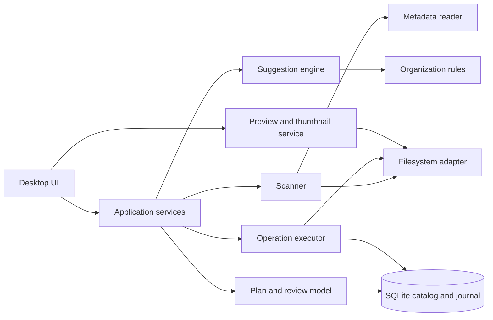

# Photo Organizer Architecture

## Status

Initial proposal for discussion. The architecture keeps filesystem behavior
behind narrow interfaces so the UI and suggestion rules can evolve without
changing the safety model.

## Goals And Constraints

- Local-first desktop application for organizing photos stored on local drives.
- Analysis and planning are read-only; all mutations pass through explicit
  review, approval, validation, and execution.
- Rename, move, and recoverable removal are auditable and reversible where the
  filesystem state permits.
- A failure affecting one file must not erase the result or status of other
  actions in the same batch.

## Proposed Technology Baseline

- Python 3.12 or newer for the application and filesystem services.
- PySide6 for a cross-platform desktop UI.
- SQLite for settings, scan metadata, and operation history; image files stay
  in their existing locations.
- Pillow behind a preview/thumbnail interface, with metadata parsing isolated
  behind a metadata-reader interface. Add an external metadata tool only if
  required by the chosen format-support target.

These are recommendations, not requirements. Confirm OS, formats, and
packaging needs before committing to dependencies.

## Component View



## Responsibilities

- **Desktop UI:** Folder selection, rule configuration, scan progress, image
  preview, action review, approval, execution progress, history, and undo.
  It does not perform filesystem mutations directly.
- **Application services:** Coordinate scan, suggestion, review, and execution
  use cases. Enforce the approval boundary and translate service results into
  UI-friendly states.
- **Scanner:** Enumerate supported files under selected roots, gather stable
  file identity and filesystem facts, and request metadata. Scanning is
  read-only and reports per-file errors.
- **Metadata reader:** Extract available capture dates and other chosen fields.
  Return values with provenance and parse status; do not silently invent
  metadata.
- **Suggestion engine:** Apply deterministic, user-configured rules to scan
  records. Produce proposed actions and explanations, never filesystem effects.
- **Plan and review model:** Hold the exact candidate actions, warnings,
  selection state, and approval snapshot shown to the user.
- **Operation executor:** Revalidate approved actions immediately before each
  mutation, execute one action at a time, journal state transitions, and
  continue safely after an individual failure.
- **Filesystem adapter:** Own path normalization, collision checks, moves,
  renames, holding-area operations, and platform-specific behavior.
- **Preview service:** Generate bounded thumbnails/previews without changing
  originals; cache generated data locally and make cache rebuildable.
- **SQLite catalog and journal:** Persist settings, optional scan cache, plans,
  per-action outcomes, and undo information. The database is not the source of
  truth for the current state of files; revalidate against the filesystem.

## Core Data Concepts

- **Scan record:** Source path, file size, modification time, supported type,
  discovered metadata, metadata provenance, and scan status.
- **Suggestion:** Proposed action (`rename`, `move`, or `remove`), source,
  destination or holding-area target, rationale, warnings, and rule version.
- **Approved plan:** Immutable snapshot of the selected suggestions at the
  moment the user confirms. Persist a plan identifier and approval timestamp.
- **Operation record:** Plan/action identifiers, state, timestamps, paths,
  outcome/error, and enough prior-state information for a safe undo attempt.
- **Settings:** User-configurable preferences persisted in SQLite, including
  active organization rules, default folder/filename pattern, and a cache
  memory limit (`cache_ram_limit_mb`) that bounds in-memory scan/thumbnail
  caching before it spills to the file-based cache described below.

Suggested per-action states:

`proposed -> approved -> running -> succeeded | skipped | failed`

An interrupted `running` action is marked `interrupted` on recovery and is
reconciled against actual source and destination state before any retry.

## Data And Execution Flow

1. The UI asks the scanner to enumerate selected roots. The scanner reads file
   facts and metadata and returns scan records without changing files.
2. The suggestion engine applies the selected rules and returns candidate
   actions with rationale and warnings.
3. The review UI allows preview and selection changes. Approval snapshots the
   selected action set; editing rules or rescanning creates a new plan.
4. The executor rechecks source identity/existence and destination availability
   for each approved action. A changed source or collision is skipped and
   reported, not silently adjusted.
5. The executor journals intent, performs the filesystem operation, then
   journals the observed result. A batch is not treated as atomic.
6. The history view uses the journal to show outcomes and offer undo when
   current filesystem state makes it safe.

## Safety Invariants

- Only the executor may request filesystem mutations, and only for an approved
  plan.
- Never overwrite an existing destination. Conflict resolution is a review
  decision and produces a newly approved plan.
- Revalidate file identity and relevant source facts immediately before action;
  size and modification time are useful checks but may not uniquely identify a
  file, so stronger identity checks should be used where available.
- Prefer same-volume atomic rename/move primitives where supported. A
  cross-volume move may require copy-then-verify-then-remove; document and
  journal its intermediate states and do not report success before verification.
- Removal moves to a recoverable holding area. Permanent deletion requires a
  separate future workflow and explicit confirmation.
- Undo is conditional: verify that the moved file is still at the recorded
  destination and that restoring it will not overwrite another file.
- Do not follow directory symlinks by default. Define and test file-symlink
  behavior for each supported OS.
- Avoid logging image contents or unnecessary personal metadata. Store only
  fields needed for suggestions, display, recovery, and history.

## Storage And Recovery

SQLite stores schema-versioned application state under the user's local
application-data directory. Store paths in a normalized, platform-aware form;
never assume a path remains valid just because it exists in the catalog.

For each operation, persist an intent record before mutation and a completion
record after checking the resulting filesystem state. On startup, find records
left in `running`, inspect source and destination, then present a recovery
status. Do not automatically repeat an ambiguous operation.

Removal uses an application-managed holding area (quarantine), not the OS
recycle bin. Record the original path and holding path, avoid collisions, and
make retention and restore behavior visible to the user. The retention period
(how long a quarantined file is kept before it is eligible for permanent
deletion, and what triggers that cleanup) is still an open decision.

## Caching And Resource Limits

Scan metadata and generated thumbnails are cached to avoid repeated
filesystem and decode work. The cache is file-based on local disk, keyed by
file identity, and must be safely rebuildable if cleared.

An in-memory working set is kept bounded by the `cache_ram_limit_mb` setting
(see Settings in Core Data Concepts). As memory use approaches that limit, the
cache evicts entries to the file-based store rather than growing unbounded.
Proposed default: 512 MB, user-adjustable. This default and the eviction
thresholds are a starting point and should be validated against real
measurements at the ~30,000-file target library size before being finalized.

## Testing Strategy

- Unit tests for date/rule evaluation, deterministic naming, normalization,
  conflict detection, and plan selection.
- Filesystem integration tests using temporary directories for rename, move,
  holding-area removal, undo, collision, changed-source, permission failure,
  cross-volume limitations where testable, and interrupted operations.
- UI-level tests for scan/review/approval/results, including keyboard access
  and ensuring no mutation occurs before approval.
- Use synthetic fixtures and generated images; tests must not operate on a
  user's real photo library.

## Suggested Module Layout

```text
src/photo_organizer/
  app/              # use cases and orchestration
  domain/           # records, plans, rules, and state transitions
  scanning/         # traversal and metadata readers
  filesystem/       # platform adapter and operation primitives
  persistence/      # SQLite repositories and migrations
  preview/          # thumbnail generation and cache
  ui/               # PySide6 views and view models
 tests/
  unit/
  integration/
  ui/
```

## Open Decisions

This is the single canonical decision log for the project (requirements.md
points here rather than keeping a separate list).

- **Target OS and packaging:** Decided — Windows only, packaged as a
  portable PyInstaller `--onedir` bundle (see packaging/build_windows.ps1
  and README.md "Package it as a standalone app"). No formal installer
  (Setup.exe) yet — the bundle folder is copied, not installed.
  **Still open:** update mechanism (there is none yet — a new build fully
  replaces the old folder), and whether a real installer or code-signing
  is worth adding later. **Known risk, not yet resolved:** the unsigned
  `.exe` has no reputation with Windows, so Smart App Control or similar
  WDAC-style policies on a target machine may block it outright —
  confirmed reproducible on the dev machine during packaging. This is a
  per-machine risk to check on the actual target computer, not a defect in
  the build.
- **Image format support:** Open — initial supported-format list, and whether
  RAW/HEIC require external tooling beyond Pillow, still need to be confirmed.
- **Default and custom organization rules:** Decided — users can edit the
  active destination folder/filename pattern via placeholders (`{year}`,
  `{month}`, `{day}`, `{name}`, `{ext}`); see requirements.md US-14.
  **Still open:** whether multiple named/saved rule presets are supported
  (deferred; one editable pattern is enough for now).
- **Holding-area implementation:** Decided — application-managed quarantine,
  not the OS recycle bin (see Storage And Recovery).
  **Still open:** retention policy and cleanup trigger.
- **Scan/thumbnail caching:** Decided — file-based cache with a bounded
  in-memory working set (see Caching And Resource Limits).
  **Still open:** validating the proposed 512 MB default and eviction
  thresholds against real measurements.
- **Library size and minimum machine:** Decided — target library size of
  30,000 files.
  **Still open:** minimum supported machine (CPU/RAM floor) and background
  worker strategy for keeping the UI responsive at that scale.
- **Duplicate detection:** Decided — deferred; not included in the first
  release. 